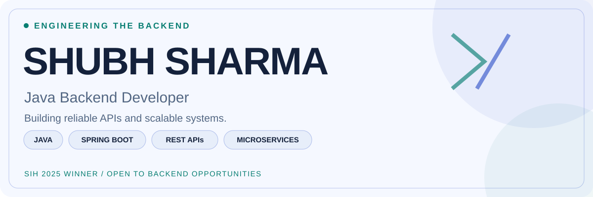
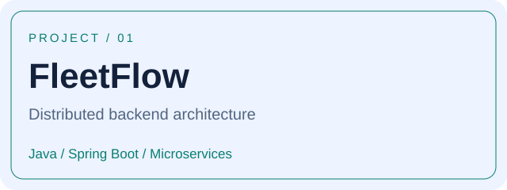
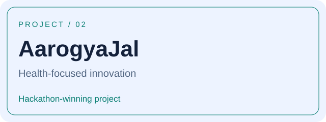

<picture>
<source media="(prefers-color-scheme: dark) and (max-width: 700px)" srcset="./assets/hero-dark-mobile.svg">
<source media="(prefers-color-scheme: light) and (max-width: 700px)" srcset="./assets/hero-light-mobile.svg">
<source media="(prefers-color-scheme: dark)" srcset="./assets/hero-dark-desktop.svg">

</picture>

**Java · Spring Boot · REST APIs · Microservices · MySQL**

[LinkedIn](https://www.linkedin.com/in/shubh-sharma-1171bb328/) · [Email](mailto:shubhsharma23nov@gmail.com) · [Repositories](https://github.com/ShubhSharma23NOV?tab=repositories)

## About me

I'm **Shubh Sharma**, a backend-focused developer building Java and Spring Boot applications. I enjoy designing APIs, understanding distributed systems and solving real-world engineering problems.

**Focus:** Java backend development · API design · Spring ecosystem · Microservices

## Selected work

| FleetFlow | AarogyaJal |
|:--|:--|
| <picture><source media="(prefers-color-scheme: dark)" srcset="./assets/project-fleetflow-dark.svg"></picture> | <picture><source media="(prefers-color-scheme: dark)" srcset="./assets/project-aarogyajal-dark.svg"></picture> |
| Distributed backend architecture using Spring Boot and microservices concepts. | Health-focused innovation recognized through SIH 2025 and the Global Innovation Excellence Award 2026. |
| [Browse projects](https://github.com/ShubhSharma23NOV?tab=repositories) | [Browse projects](https://github.com/ShubhSharma23NOV?tab=repositories) |

## Toolkit

**Backend:** Java · Spring Boot · Spring Security · REST APIs · Microservices

**Data & tooling:** MySQL · Maven · Git · GitHub · Docker

## Recognition

| Achievement | Result |
|---|---|
| **Smart India Hackathon 2025** | Winner — 1st among 500+ teams for the problem statement |
| **Global Innovation Excellence Award 2026** | Winner — AarogyaJal, W-AHEAD, New Delhi |
| **IEEE Ignite 2.0** | 2nd — Research Paper Presentation |
| **IEEE Ignite 2.0** | 3rd — Paper Presentation |
| **RAMSITA International Conference 2026** | 1st — Poster Presentation (among 30 teams) |
| **Mediverse Hackathon, Medicaps University** | 3rd (among 40 teams) |

## Leadership & community

- **Advisor**, IEEE Student Branch, AITR (ongoing)
- **Content Writing Head**, IEEE TEMS Student Branch (ongoing)
- Conducted a cyber-awareness podcast with **ADCP Crime Branch Mr. Rajesh Datodiya**
- Designed **2 newsletters** and **2 Books of Abstracts** for the CSIT Department, AITR

## GitHub activity

---

**Let's build something useful.**

[GitHub](https://github.com/ShubhSharma23NOV) · [LinkedIn](https://www.linkedin.com/in/shubh-sharma-1171bb328/) · [Email](mailto:shubhsharma23nov@gmail.com)

